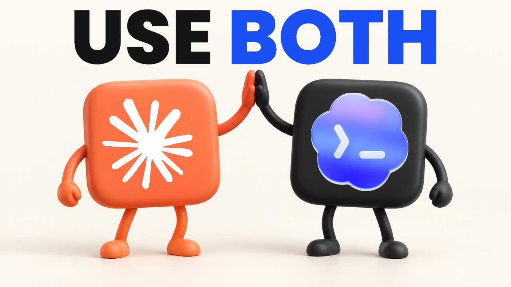

# Use Both — Claude + Codex Workflow Kit

**🇧🇷 [Português](README.md) · 🇺🇸 [English](README.en.md) · 🇪🇸 [Español](README.es.md)**

[](https://inematds.github.io/use-both-claude-codex/guia/)

**Planeje com um. Desafie com o outro. Mantenha o projeto andando.**

Kit gratuito para usar Claude e Codex juntos: seis fluxos, prompts prontos, templates, um guia em PDF e duas skills (`handoff` e `prime`) para trocar de assistente sem reexplicar o projeto.

## 📖 Guia de uso

Guia completo (landing + passo a passo): **https://inematds.github.io/use-both-claude-codex/guia/**

## Origem e licença

Este repositório espelha o kit **Use Both: Claude + Codex Workflow Kit v1.0.0**, de Prompt Advisers (Mark Kashef), publicado sob licença MIT em
[earlyaidopters/gumroad-resources](https://github.com/earlyaidopters/gumroad-resources/tree/main/resources/use-both-claude-codex-workflow-kit) (commit `860b383`, baixado em 27/09/2026).
O INEMA acrescentou o guia trilíngue (`guia/`), a capa (`capa/`) e os READMEs em PT e ES. Os documentos do kit (`GUIDE.md`, `PROMPTS.md`, `START-HERE.md`, `docs/`, `skills/`, `templates/`) estão no original em **inglês**. Veja [LICENSE](LICENSE) e [ASSET-NOTICE.md](ASSET-NOTICE.md).

## Os seis níveis

1. **Deixe discutirem:** um assistente escreve, o outro critica o mesmo artefato. No máximo duas rodadas.
2. **Gerar imagem:** só com a ferramenta disponível na sessão e sabendo como ela cobra; o entregável é o arquivo.
3. **Dividir o trabalho:** um constrói numa branch, o outro revisa o diff. Testes e sua aprovação decidem.
4. **Computer use supervisionado:** senha, pagamento e envios com consequência ficam com você.
5. **Linha de chegada:** meta mensurável e condição de parada.
6. **Handoff:** o estado vai para um arquivo portátil, e o próximo assistente lê e confere antes de continuar.

## Começo rápido

```bash
python3 -m unittest discover -s tests -v
python3 examples/task-board/test_task_board.py

# prévia (nada muda) e depois aplicar num projeto seu
python3 scripts/install_skills.py --project /caminho/do/projeto --target both
python3 scripts/install_skills.py --project /caminho/do/projeto --target both --apply
```

No Claude Code: `/handoff` no fim da sessão e `/prime` na próxima. No Codex: `$handoff` e `$prime`.

## O vídeo

Resumo do vídeo "Use Both" e o que ele acrescenta ao kit (conexão por CLI, custo do `/goal`, imagem pela assinatura do Codex, onde seguimos o kit e não o vídeo): [docs/RESUMO-VIDEO.md](docs/RESUMO-VIDEO.md).

## Relacionados no INEMA

- [agente-claude-codex](https://inematds.github.io/agente-claude-codex/guia/): migrar do Claude para o Codex ou ficar agnóstico
- [Curso Claude → Codex](https://inematds.github.io/curso-claude-codex/)
- [Área Codex + Claude no INEMA Eventos](https://eventos.inema.pro/claude-codex/)

Material educacional independente, sem vínculo com a OpenAI nem com a Anthropic.

---

Projeto adaptado da comunidade INEMA TDS - Marca Arckhe